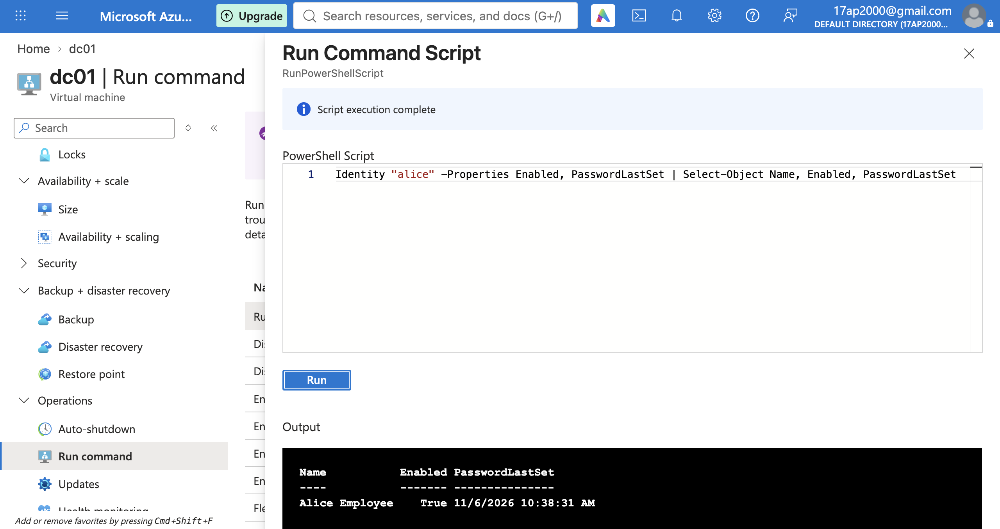
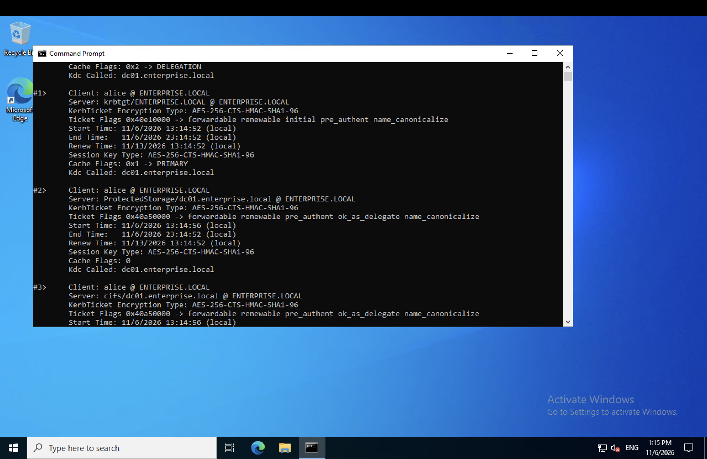
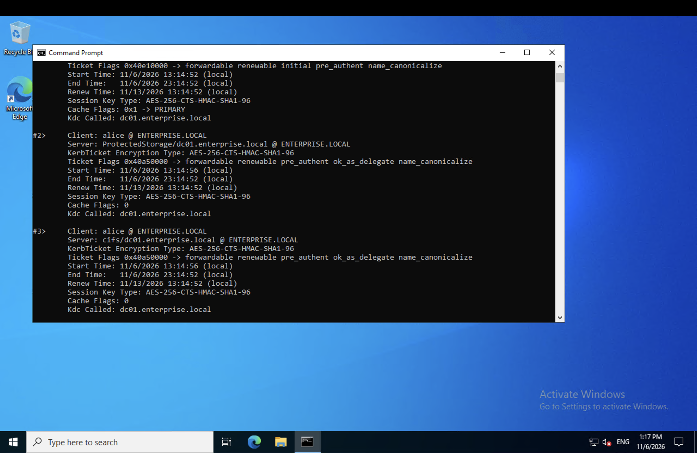
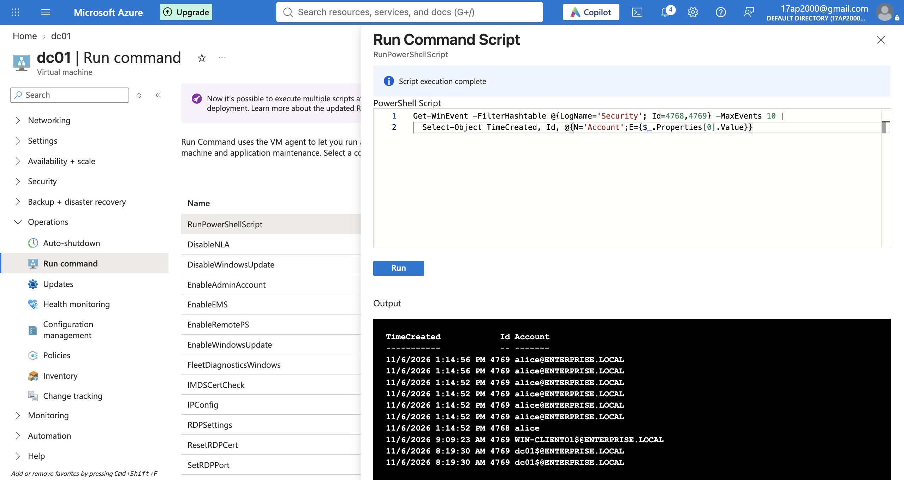

# Phase 4 — Kerberos Fundamentals

## Objective

Demonstrate a real Kerberos authentication cycle — a TGT request followed
by a service ticket request — using an ordinary domain user account, and
correlate each step with the matching Windows Security event on dc01.

A machine-level Run Command session executes as the SYSTEM account, not as
an interactive domain user, so it cannot produce a normal user logon ticket
on its own. This phase therefore requires one interactive login, obtained
through a narrowly scoped, temporary exception to the lab's normal
no-inbound-access posture.

## Step 1 — Create a standard domain user account

**Command (Run command on dc01):**

```powershell
$pwd = ConvertTo-SecureString "User@Pass2026#1" -AsPlainText -Force
New-ADUser -Name "Alice Employee" -SamAccountName "alice" -UserPrincipalName "alice@enterprise.local" -AccountPassword $pwd -Enabled $true -PasswordNeverExpires $true
```

**Purpose:** creates an ordinary, non-administrative domain account. Using
an everyday account instead of the domain Administrator mirrors how a real
employee authenticates, and keeps the administrator credential out of a
routine login workflow.

**Verification:**

```powershell
Get-ADUser -Identity "alice" -Properties Enabled, PasswordLastSet | Select-Object Name, Enabled, PasswordLastSet
```

Confirms the account exists, is enabled, and has a password set.

**Evidence:** 

## Step 2 — Temporarily permit interactive logon

**Action:** Portal → `nsg-client` → Inbound security rules → Add.

| Setting | Value |
|---|---|
| Source | My IP address (scoped to your current public IP only) |
| Destination port | 3389 (RDP) |
| Priority | 100 |
| Name | `temp-rdp-ticket-capture` |

**Purpose:** a Kerberos TGT is only issued at the point a user actually
authenticates interactively. This is the one point in the lab where a
temporary, narrowly scoped exception to the no-inbound-access rule is
justified and deliberately time-boxed — the rule is removed again in Step 6,
immediately after the evidence is captured.

## Step 3 — Log in as the domain user and inspect the TGT

**Action:** RDP into win-client01 as `ENTERPRISE\alice`, using the password
set in Step 1. Open Command Prompt.

**Command:**

```
klist
```

**Purpose:** `klist` lists every Kerberos ticket currently cached on the
machine for the logged-in session. Immediately after login, this should
show a single entry: the TGT (`krbtgt/ENTERPRISE.LOCAL`), proving alice has
authenticated to the KDC and received a Ticket-Granting Ticket.

**Result:** confirmed — a single cached ticket (`krbtgt/ENTERPRISE.LOCAL`) present immediately after login.

**Evidence:** 

## Step 4 — Trigger a service ticket request

**Command (same Command Prompt session):**

```
dir \\dc01\netlogon
klist
```

**Purpose:** accessing a network resource on dc01 forces Windows to request
a service ticket (TGS) for that specific service, using the TGT from Step 3
rather than re-sending a password. Running `klist` again shows a second
cached ticket has appeared, issued for the `cifs/dc01.enterprise.local`
service — this is the TGS/service ticket exchange in practice.

**Result:** confirmed — a second cached ticket (`cifs/dc01.enterprise.local`) appeared following the network access, alongside the original TGT.

**Evidence:** 📸 

## Step 5 — Correlate with the Security event log on dc01

**Command (Run command on dc01):**

```powershell
Get-WinEvent -FilterHashtable @{LogName='Security'; Id=4768,4769} -MaxEvents 10 |
  Select-Object TimeCreated, Id, @{N='Account';E={$_.Properties[0].Value}}
```

**Purpose:** Event ID **4768** is logged on the domain controller each time
a TGT is issued; **4769** each time a service ticket is issued. Filtering
for both and matching their timestamps against Steps 3 and 4 proves the
`klist` output wasn't just a local client-side artifact — it corresponds to
a real, logged authentication event on the domain controller itself. This
is the same event pair the detection in Phase 7 (Kerberoasting) is built
on top of.

**Result:** confirmed — Event ID 4768 and Event ID 4769 both logged for account `alice`, with timestamps matching the TGT and service ticket captured in Steps 3 and 4.

**Evidence:** 


## Step 6 — Remove the temporary access

**Action:** Portal → `nsg-client` → delete the `temp-rdp-ticket-capture`
rule created in Step 2.

**Purpose:** restores the lab's no-inbound-internet-access posture now
that the interactive session needed to capture these tickets is complete.

## Outcome

A real Kerberos TGT and service ticket were issued, observed with `klist`
on win-client01, and correlated with Event IDs 4768 and 4769 on dc01,
completing the legitimate authentication.
